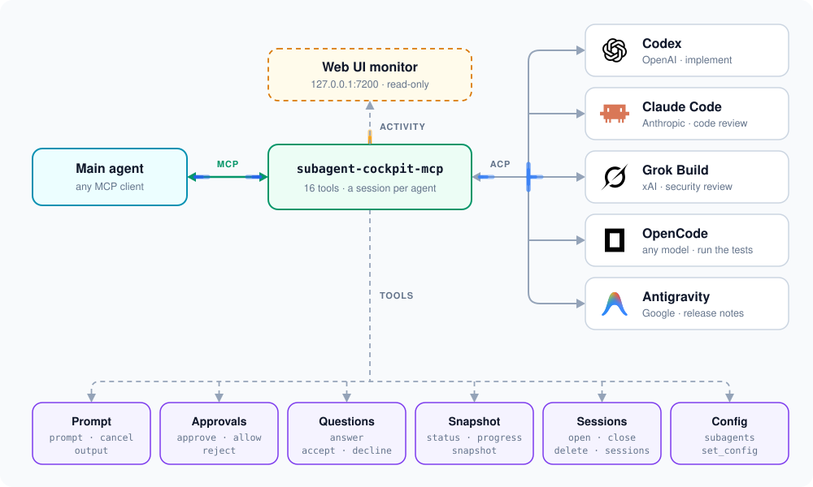
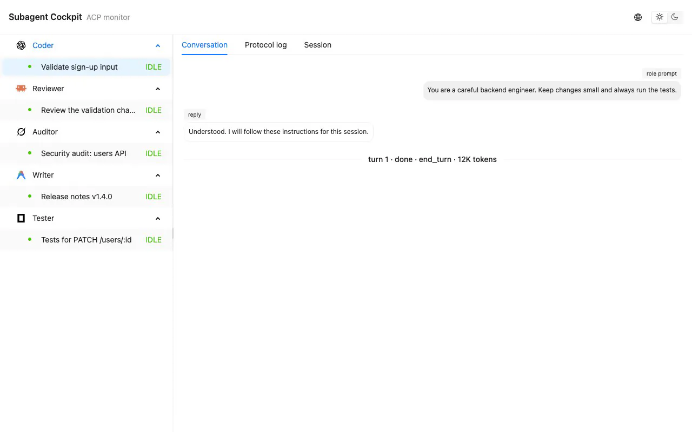

# subagent-cockpit-mcp

> One MCP server, five coding agents from five vendors: OpenAI Codex, Claude Code, Grok, OpenCode and Google Antigravity.

Let the agent you already use (Claude Code, Codex CLI, Cursor, any MCP client) hand work to the other coding agents on your machine. One writes the code, the others review it, test it and draft the release notes.

<picture>
  <source media="(prefers-color-scheme: dark)" srcset="assets/overview-dark.svg">
  
</picture>

- Mix vendors. Each role gets the agent and model that suits it, all behind the same 16 tools.
- Work in parallel. `prompt(wait: false)` sends tasks to several agents at once, `status` and `output` collect the results.
- Keep context. Review findings go back to the session that wrote the code. Reconnect to a session by id days later.
- Stay in charge. Approvals and questions come back to the main agent, and `allow` lasts for one session only.
- No screen scraping. Every agent runs over the [Agent Client Protocol](https://agentclientprotocol.com) (ACP).
- Watch it live. A read-only page at `http://127.0.0.1:7200` shows every session as it runs.

## Web UI

Open `http://127.0.0.1:7200` to watch the sessions: replies as they stream, tool calls with their diffs, plans, approvals and questions, plus a protocol log of every raw ACP message.

<picture>
  <source media="(prefers-color-scheme: dark)" srcset="assets/webui-dark.webp">
  
</picture>

- Read-only. The page watches and never acts. Approvals and answers still go through the tools.
- Starts and stops by itself. The first MCP server that finds the port free starts it, and every server on the machine reports to the same page. It exits about 10 seconds after the last server goes away.
- Memory only. Nothing is written to disk. A web UI started again shows the sessions that are still open, not the old messages.
- Port. `"webui": { "port": 7200 }` in the config, or `SUBAGENT_COCKPIT_WEBUI_PORT`, which wins. `0` turns it off. When another program holds the port, the server says so on stderr and runs without the web UI.
- Privacy. The page shows the ACP messages as sent, prompts and `args` included. It listens on 127.0.0.1 only, but other users of the same machine can open it.
- Font. The conversation tab is monospace. Install [Sarasa Mono SC](https://github.com/be5invis/Sarasa-Gothic) (or Noto Sans Mono CJK SC) and Chinese lines up with Latin text at exactly two columns per character; without it Chinese falls back to the system font.

## Quick start

1. Install Node.js 22+ and the agents you want, and log in to each. The server never downloads them.

   | Agent | Version | Install |
   |---|---|---|
   | OpenAI Codex | 0.160.1+ | `brew install --cask codex` or `npm i -g @openai/codex` |
   | Anthropic Claude Code | 2.1.292+ | `brew install --cask claude-code` or the [official installer](https://code.claude.com/docs/en/setup) |
   | xAI Grok Build | 1.0.46+ | `brew install --cask grok-build` |
   | OpenCode | 2.0.30+ | `brew install opencode` (the 1.x `opencode-ai` on npm is not supported) |
   | Google Antigravity | 1.4.2+ | `brew install --cask antigravity-cli`, then run `agy` once to sign in |

2. Add the server to your MCP client:

   ```bash
   claude mcp add subagent-cockpit -- npx -y subagent-cockpit-mcp
   ```

   Claude Code asks before each MCP tool call. To let it drive the subagents without asking, allow the whole server in `~/.claude/settings.json` or the project's `.claude/settings.json`:

   ```json
   { "permissions": { "allow": ["mcp__subagent-cockpit"] } }
   ```

   Codex CLI (`~/.codex/config.toml`):

   ```toml
   [mcp_servers.subagent-cockpit]
   command = "npx"
   args = ["-y", "subagent-cockpit-mcp"]
   tool_timeout_sec = 1800                  # default 60, longer means fewer status checks
   default_tools_approval_mode = "approve"  # needed for `codex exec`
   ```

   Cursor (`.cursor/mcp.json` or `~/.cursor/mcp.json`):

   ```json
   { "mcpServers": { "subagent-cockpit": { "command": "npx", "args": ["-y", "subagent-cockpit-mcp"] } } }
   ```

3. Give each agent a role in `~/.subagent-cockpit/config.json` (created on first start):

   ```json
   "subagents": {
     "coder":    { "adapter": "codex",       "role": "You implement changes in this repository." },
     "reviewer": { "adapter": "claude",      "mode": "plan", "role": "You review diffs. Report findings, do not edit files." },
     "security": { "adapter": "grok",        "role": "You look for security issues in diffs. Do not edit files." },
     "tester":   { "adapter": "opencode",    "role": "You run the test suite and report failures." },
     "docs":     { "adapter": "antigravity", "model": "gemini-3.8-flash", "role": "You draft release notes as text. Do not edit files." }
   }
   ```

4. Ask your main agent:

   > Use subagent-cockpit. Have the coder add rate limiting to the API. Have the reviewer and the security subagent review the diff, and send their findings back to the coder until both pass. Then have the tester run npm test, ask the docs subagent for release notes, and report.

## Supported agents

| Agent | Connected through | Approvals | Questions | `delete` |
|---|---|---|---|---|
| Codex | bundled [`codex-acp`](https://www.npmjs.com/package/@agentclientprotocol/codex-acp) | yes | in `plan` mode | archives |
| Claude Code | bundled [`claude-agent-acp`](https://www.npmjs.com/package/@agentclientprotocol/claude-agent-acp) | yes | `AskUserQuestion` | deletes the transcript |
| Grok Build | grok's own ACP | yes | plain text only | deletes the session files |
| OpenCode | opencode's own ACP | yes | `question` tool | deletes the session |
| Antigravity | bundled bridge over `agy -p` | denied by agy, see [notes](#notes) | skipped by agy | not supported |

Verified with codex 0.162.1, claude 2.1.292, grok 1.0.46, opencode 2.0.30 and agy 1.4.3. There is no upper version bound. A release that breaks the protocol fails with `AGENT_ERROR` until the server is updated. This is the ACP rewrite of [subagent-cli](https://github.com/yejianfei/subagent-cli).

## Tools

| Group | Tools |
|---|---|
| Prompt | `prompt` sends a task, `cancel` stops the turn, `output` returns the last reply |
| Approvals | `approve` allows once, `allow` allows similar calls for the rest of the session, `reject` refuses |
| Questions | `answer` accepts, declines or cancels a question from the agent |
| Snapshot | `status` shows the state and what is pending, `progress` the agent's plan and context usage, `snapshot` the full conversation |
| Sessions | `open` creates, reuses or reconnects, `close` keeps the history, `delete` removes it, `sessions` lists them |
| Config | `subagents` lists the configured agents, `set_config` changes `model`, `reasoning_effort` or `mode` |

`prompt`, `approve`, `allow`, `reject` and `answer` wait as long as the turn takes and return `done` with the output, `approval_needed` or `question_needed`. Pass `wait: false` to return right away. The server never times out a turn. If your client gives up first, the turn keeps running, and `status` and `output` pick it up.

`open` with `reuse: true` takes an idle session of this server with the same `cwd` and subagent, else reconnects the latest closed one on disk. If that one cannot be reconnected, you get a new session and a `reuse_skipped` note, and the broken one is not picked again.

`snapshot` returns the conversation exactly as the Web UI shows it: prompts, replies, thinking, tool calls with their input, output and diffs, plans, approvals, questions and agent-specific messages, one item each, plus every session's state and pending notifications. Narrow it down when you only need part of it:

```json
{ "session": "codex_019a…", "types": ["tool"], "last": 5 }
{ "session": "codex_019a…", "exclude_types": ["thought", "raw"] }
{ "since": 1287, "server_id": "f3c1…" }
```

`types` keeps and `exclude_types` drops item kinds (`prompt`, `message`, `thought`, `tool`, `plan`, `turn` and the rest), `last` takes the last few, and `since` with the `seq` and `server_id` of the previous call returns only what changed. `reset: true` means start over from the items returned.

## Configuration

`~/.subagent-cockpit/config.json` is created on first start with one entry per agent. An entry using every field:

```json
{
  "idle": { "timeout": 0 },
  "webui": { "port": 7200 },
  "subagents": {
    "reviewer": {
      "adapter": "claude",
      "description": "Reviews diffs",
      "role": "You review diffs. Report findings, do not edit files.",
      "model": "opus",
      "reasoning_effort": "high",
      "mode": "plan",
      "path": "/opt/homebrew/bin/claude",
      "args": ["--add-dir", "/data"],
      "env": { "CLAUDE_CONFIG_DIR": "/path/to/claude-config", "ANTHROPIC_API_KEY": "${ANTHROPIC_API_KEY}" }
    }
  }
}
```

A `subagents` object you write replaces the default entries as a whole. `idle.timeout` closes sessions idle that many seconds. The default `0` never closes them, since the server and its agents exit with your MCP client anyway. A session closed this way comes back by itself on the next `prompt` or `set_config`, settings included; `status` meanwhile reports it `CLOSED`. `webui.port` is the [Web UI](#web-ui) port, `0` for none. `SUBAGENT_COCKPIT_HOME` moves the whole `~/.subagent-cockpit` directory.

The Web UI and `snapshot` keep the latest 5000 ACP messages per session, and show any message over 1 MB (1048576 bytes) as a truncation marker. Each has its own setting, in bytes and counts:

```json
{
  "webui": { "port": 7200, "truncate_message_size": 1048576, "max_message_count": 5000 },
  "snapshot": { "truncate_message_size": 1048576, "max_message_count": 5000 }
}
```

Conversation items go with the messages behind them. The Web UI keeps the `max_message_count` of the server that started it.

| Field | Meaning |
|---|---|
| `adapter` | `codex`, `claude`, `grok`, `opencode` or `antigravity` |
| `description` | Shown by the `subagents` tool |
| `role` | Role prompt sent to every new session |
| `model`, `reasoning_effort`, `mode` | Initial settings for new sessions (Claude and OpenCode call the effort `effort`). A session keeps its settings, `set_config` changes included, and gets them back when you reconnect. `open` and `snapshot` list the values each agent accepts |
| `path` | The agent program. Empty means look it up in `PATH` |
| `args`, `env` | Extra command-line args and environment. `${VAR}` reads the server's environment, `""` or `null` removes a variable |
| `profile` | Settings shared by several subagents, see below |

| Agent | `mode` | `args` |
|---|---|---|
| Codex | `read-only`, `workspace-write`, `agent`, `agent-full-access` | ignored |
| Claude Code | `default`, `acceptEdits`, `plan`, `auto`, `bypassPermissions` | passed to claude, e.g. `["--add-dir", "/data"]` |
| Grok | not supported | between `grok agent --no-leader` and `stdio`, e.g. `["--always-approve"]` |
| OpenCode | `build`, `plan` | after `opencode acp`. Models are `provider/model` |
| Antigravity | `accept-edits`, `plan`, `auto` | on the `agy` command line. Don't pass `--model`, `--effort`, `--mode`, `--conversation` or `-p` |

Clients started from a desktop app may hand the server a `PATH` without `/opt/homebrew/bin`. Set `path` then.

### Profiles

A profile holds settings that several subagents share. A subagent names it in `profile` and overrides what it needs:

```json
"profiles": {
  "gateway": { "env": { "ANTHROPIC_BASE_URL": "https://example.com", "ANTHROPIC_AUTH_TOKEN": "${GATEWAY_TOKEN}" } }
},
"subagents": {
  "claude":      { "adapter": "claude", "profile": "gateway" },
  "claude-fast": { "adapter": "claude", "profile": "gateway", "model": "haiku" }
}
```

Plain fields come from the subagent when set, else from the profile. `env` merges by name and `args` by `--flag`, with the subagent winning. A profile cannot name another profile, and a missing one fails with `PROFILE_NOT_FOUND`.

### Credentials and gateways

The server never logs in and never stores credentials. Each agent uses its own login unless the subagent `env` says otherwise. On `AUTH_REQUIRED`, log in with the agent's CLI or fix `env`.

- Claude Code: `ANTHROPIC_API_KEY`, or `ANTHROPIC_BASE_URL` with `ANTHROPIC_AUTH_TOKEN`. `CLAUDE_CONFIG_DIR` gives a subagent its own config directory.
- Codex: a custom provider goes in the `config.toml` of a separate `CODEX_HOME`, with its key in `env`, e.g. `{ "CODEX_HOME": "/path/to/codex-home", "OPENAI_API_KEY": "${MY_KEY}" }`. `DEFAULT_AUTH_REQUEST` makes codex-acp log in by itself and save the key in `CODEX_HOME/auth.json`.
- Grok: a custom endpoint goes in the `config.toml` of a separate `GROK_HOME`, with `XAI_API_KEY` in `env`.
- OpenCode: point `OPENCODE_CONFIG` at a config whose `providers.openai.settings` sets `baseURL` and `apiKey` (`{env:VAR}`). Add `"transport": "http"` if the gateway has no WebSocket.
- Antigravity: signs in only from its own terminal UI. For a second account, set `HOME` in `env` and run `HOME=/path/to/home agy` once.

### What the agents read from your machine

The server passes settings through and never isolates them.

- Claude Code and Grok read your Claude Code settings (including `permissions.defaultMode`), plugins and hooks. Isolate Claude Code with `CLAUDE_CONFIG_DIR`, and Grok with another `HOME` plus an explicit `GROK_HOME`.
- OpenCode reads your Claude Code skills and `CLAUDE.md`. `OPENCODE_DISABLE_CLAUDE_CODE=1` turns that off.
- Antigravity reads `~/.gemini/antigravity-cli/settings.json` (including `permissions.allow`) under `HOME`.

## Notes

- Questions. A question arrives as `question_needed` with the agent's own form in `requested_schema`. Field names differ per agent, so read them from the schema and reply with `answer({ session, question_id, content: { question_0: "Red" } })`. Approvals go first when both wait.
- Approvals. An agent's own "don't ask again" option is usually saved for good, so `allow` never picks it. It allows the call once and keeps a rule in the server until the session closes. To have the agent remember it anyway, `approve` with that option: Codex `accept_execpolicy_amendment`, Claude Code `allow-with-updates`, Grok `always-allow`, OpenCode `always`.
- Deleting. `delete` removes the server's session directory and the agent's own session. An open Claude Code session is closed first, which takes a few seconds. agy cannot delete a conversation, so it stays under `~/.gemini/antigravity-cli/`.
- Antigravity. `agy -p` is headless and never asks. A tool that needs a permission is denied, reading a file outside the session's `cwd` included, and the output ends with a note such as `agy denied in headless mode: ReadFile`. Either allow the action in `permissions.allow` of `~/.gemini/antigravity-cli/settings.json`, in agy's own form such as `read_file(<path>)`, or let that subagent skip agy's checks:

  ```json
  "docs": { "adapter": "antigravity", "args": ["--dangerously-skip-permissions"] }
  ```
- Client timeouts. Codex CLI times out tool calls after 60 seconds unless `tool_timeout_sec` is set. Claude Code aborts a call after 30 minutes without progress, and the server sends progress every 60 seconds, so long turns survive.

## Development

```bash
npm install
npm run build && npm run lint && npm test
npm run test:e2e:codex       # also :claude, :grok, :opencode, :antigravity, :concurrent
npm run check:deps           # bundled ACP adapters == verified versions
```

The diagram is hand-written SVG, `assets/overview-light.svg` and `assets/overview-dark.svg`. Keep the two in sync. Product names and logos belong to their owners.

## License

Apache-2.0
